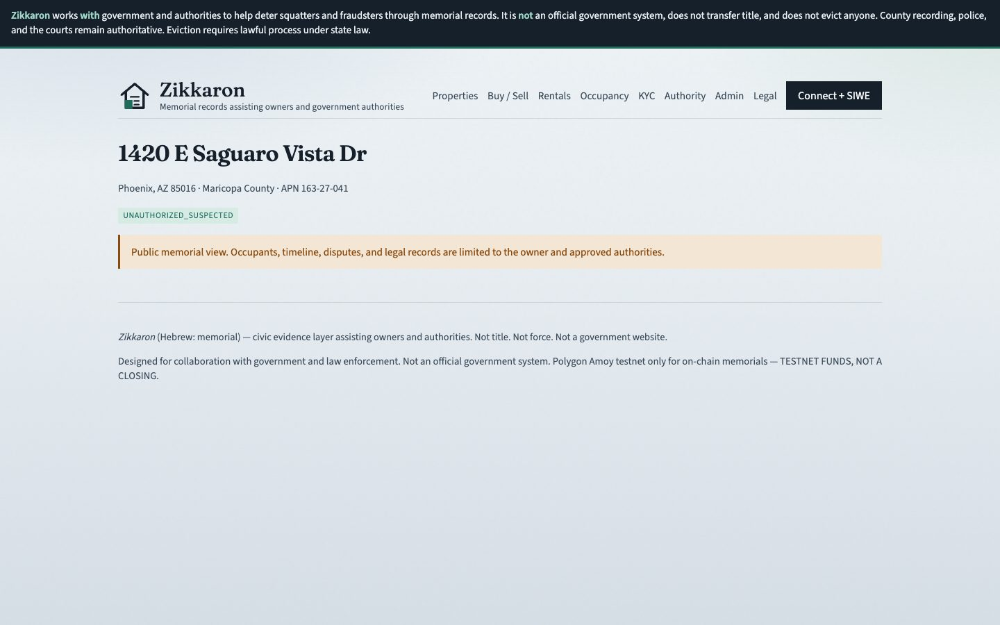
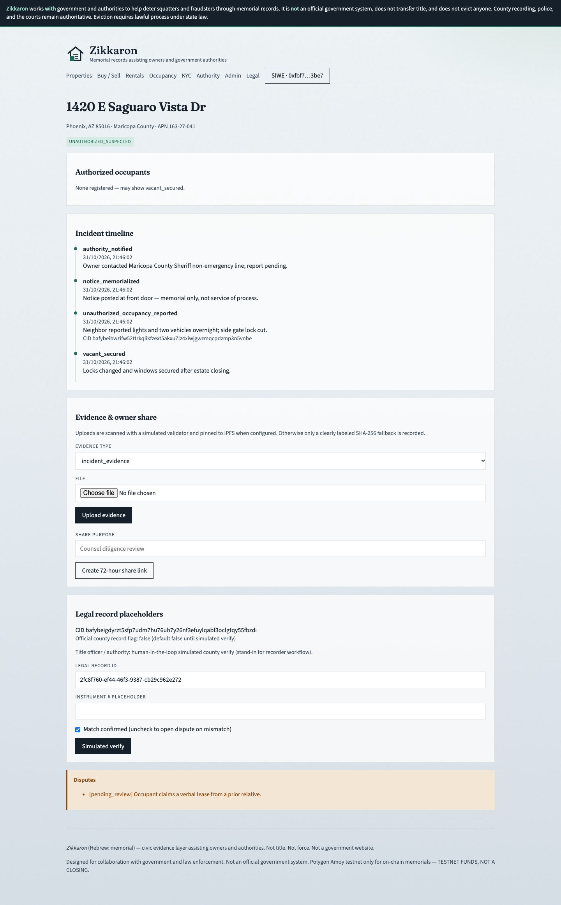

# System design — Zikkaron

## Layers

```
┌─────────────────────────────────────────────────────────┐
│  Next.js frontend (MetaMask, Amoy 80002)                │
│  /authority console · /properties · /occupancy · /kyc   │
└───────────────────────────┬─────────────────────────────┘
                            │ SIWE session cookie (httpOnly)
┌───────────────────────────▼─────────────────────────────┐
│  Express API · Zod · Helmet · CORS                      │
│  /api/authority/* · /api/properties · /api/occupancy    │
│  /api/documents · /api/shares                           │
└───────────────┬─────────────────────────────┬───────────┘
                │                             │
        PostgreSQL                     Polygon Amoy
        agencies, exports,             PropertyRegistry
        occupants, events,             PossessionMemorial
        gov_api_queue                  Escrow / KYC / etc.
                │
              IPFS CIDs (documents / evidence)
```

## On-chain modules

| Contract | Role |
|----------|------|
| UserVerification | KYC hash memorial; ADMIN / TITLE_OFFICER / AUTHORITY_OFFICER |
| PropertyRegistry | APN-bound property memorial; occupancy status |
| PossessionMemorial | Incident / notice evidence hashes |
| OwnershipTransfer | Transfer intent + simulated county verify |
| EscrowPayment | Test POL escrow (not closing) |
| RentalAgreement | Lease hash + authorized occupant flag |

NatSpec on all modules: assists owners and authorities; not title; not eviction; not an official government system.

The deployment path (`contracts/scripts/deployZikkaron.js`) uses ERC-1967 proxies for the UUPS
modules. Implementations are locked against direct initialization. When `UPGRADE_ADMIN_ADDRESS`
is set, the script grants it `ADMIN` (upgrade authority) and `DEFAULT_ADMIN_ROLE`, renounces both
from the deployer, and verifies the result.
PropertyRegistry, PossessionMemorial, and EscrowPayment expose admin pause/unpause controls.

PossessionMemorial, EscrowPayment, OwnershipTransfer, and RentalAgreement inherit
`PropertyOwnerGated`, which stores the PropertyRegistry address in ERC-7201 namespaced storage
(upgrade-safe for existing proxies) and requires `claimedOwnerOf(propertyId) == msg.sender` for
property-scoped writes. PossessionMemorial also accepts authority officers, and reserves
`AgencyAckReceived` for them. EscrowPayment buyers can `claimRefund` after `refundTimeout()`
(default 14 days), including while the contract is paused.

## Off-chain authority path

1. Search → case view (read-only)  
2. Export → `authority_case_exports` + watermark + `le_case_share_placeholder`  
3. Acknowledge → `authority_acknowledgements` + `agency_ack_received` event  

## Auth & government adapters (phased)

| Phase | Capability |
|-------|------------|
| 1 | SIWE sessions (`/api/auth/*`): httpOnly cookie for browsers, Bearer for API clients |
| 2 | Agency SSO stubs (`/api/auth/sso/*`) |
| 3 | County/assessor lookup adapters (`/api/lookups/*`, `GOV_LOOKUP_ADAPTER`) |

## Evidence path

1. Owner uploads an allowed document through `/api/documents`.
2. The API validates size/type and runs a simulated malware check.
3. IPFS is attempted when `IPFS_API_URL` is configured; otherwise a labeled SHA-256-only
   fallback is stored. Raw content is not stored in PostgreSQL.
4. Authority exports include document metadata, redaction options, and a SHA-256 manifest.
5. Owners can create expiring, purpose-labeled share links through `/api/shares`.

## Authority governance

- Privileged authority accounts must be linked to an agency.
- Exports, acknowledgements, revocations, and case records are scoped to that agency.
- Case-pack payloads default to a 90-day retention deadline.
- Admin purge redacts expired payloads while preserving export and audit metadata.

## Property access

`backend/src/services/access.js` (`assertPropertyAccess`, `propertyAccessLevel`) is the single
owner / approved-role check used by property, occupancy, document, share, lookup, and deal routes.

| Caller | Property detail | Documents / lookups | Deals |
|--------|-----------------|---------------------|-------|
| Anonymous / unrelated | Public view only | 403 | Only deals they are a party to |
| Owner | Full | Full | Full |
| Approved admin / authority / title officer | Full | Full | Full |

What an anonymous visitor sees versus the owner of the same property:

| Public view | Owner view |
|-------------|------------|
|  |  |

Disputes from anyone other than the owner or an approved authority start as `pending_review`
and do not pause the listing. `PATCH /api/occupancy/disputes/:id` (admin, authority, title
officer) opens, resolves, or dismisses them; owners cannot change occupancy status while an
open dispute exists.

## Security controls in MVP

Roles including `authority_officer`, export logging, disclaimers, peppered KYC hashes, PossessionMemorial, dispute review, default unofficial county records, production config guard, cookie CSRF origin check, and frontend security headers.
