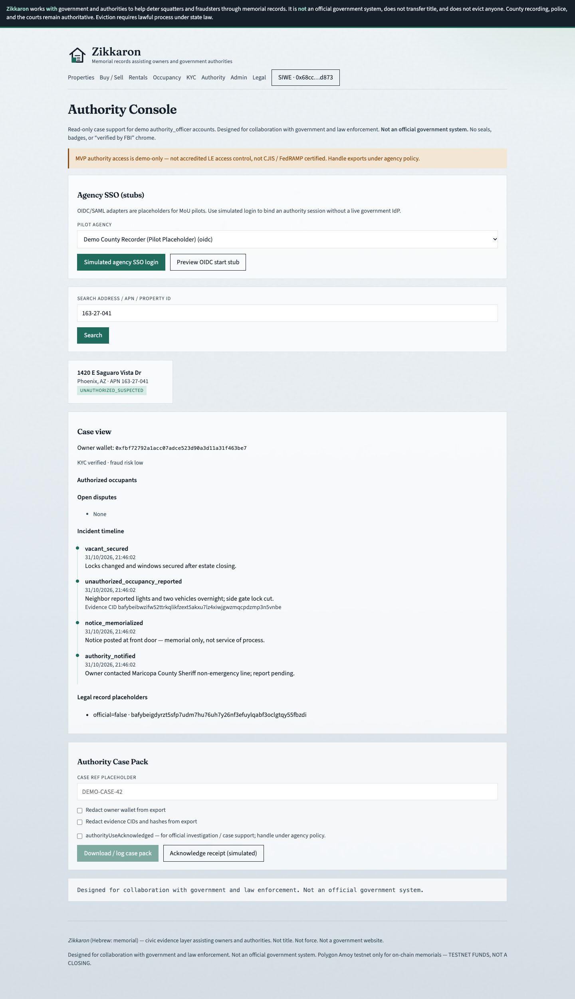

# zikkaron-frontend

Next.js 14 app for Zikkaron.

```bash
cp .env.local.example .env.local
npm run dev -w zikkaron-frontend
```

Routes: `/`, `/properties`, `/properties/[id]`, `/buy-sell`, `/rentals`, `/occupancy`, `/kyc`, `/legal`, `/admin`, **`/authority`**.

MetaMask → Polygon Amoy. Persistent partnership banner on every page.

Sign-in is SIWE; the API keeps the session in an httpOnly cookie, so the app never stores a
token and every request uses `credentials: "include"`. `next.config.js` sets a CSP plus
`X-Frame-Options`, `Referrer-Policy`, and `Permissions-Policy` headers. Anonymous visitors get
the public property view; owner-only panels render only when the API grants owner or authority
access.



More screens and regeneration steps: [docs/screenshots](../docs/screenshots/README.md).
